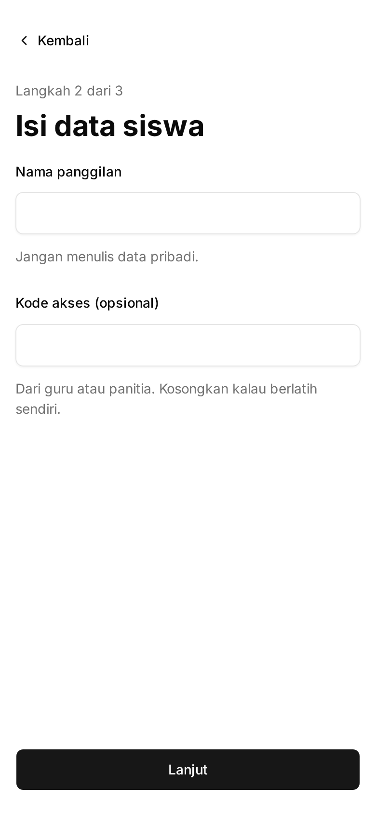
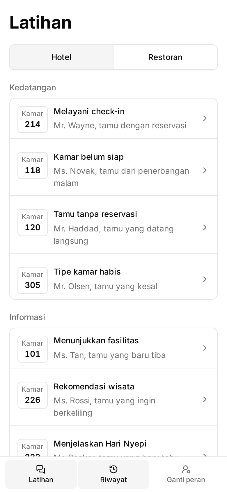
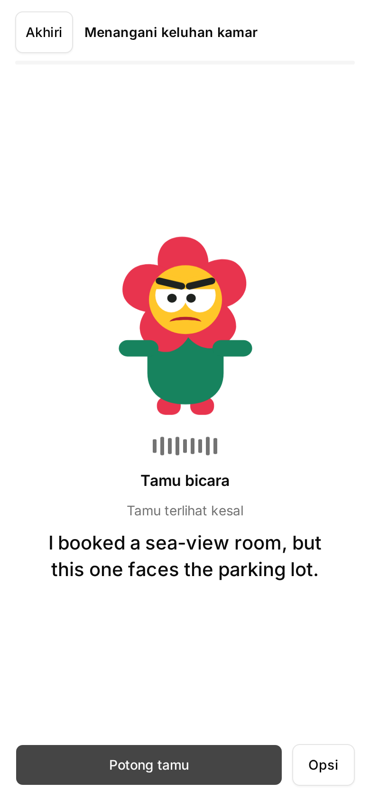
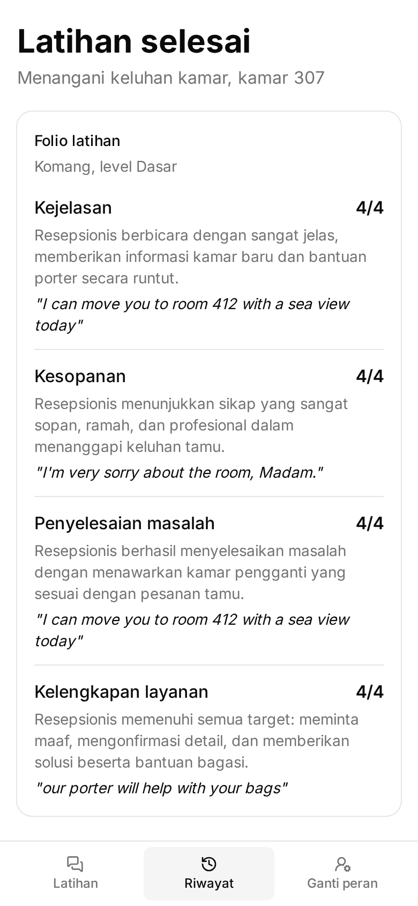
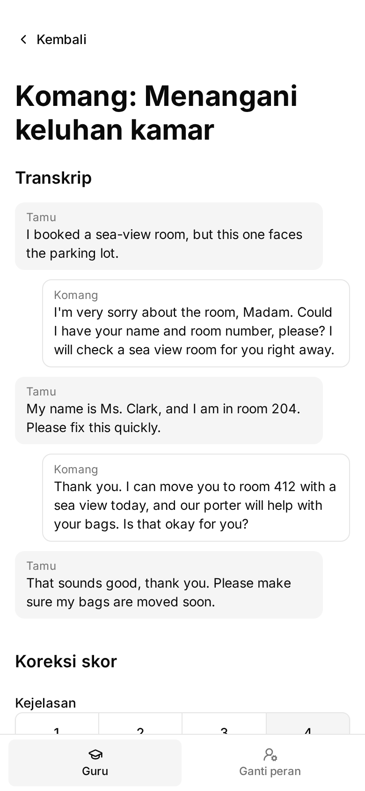

# Sapa Tamu

## Description

Sapa Tamu adalah aplikasi web latihan percakapan bahasa Inggris untuk pekerjaan di hotel dan restoran. Pengguna berbicara dengan tamu simulasi berbasis AI, lalu menerima folio berisi skor latihan, kutipan jawaban, dan contoh perbaikan. Guru dapat meninjau transkrip dan mengoreksi skor.

## Problem & Target User

Astawa dkk. (2017) menganalisis tes bahasa Inggris di SMK Pariwisata Bali dan mengusulkan tes komunikatif seperti role play dan oral interview. Pada tes yang dianalisis, sebagian besar soal berupa pilihan ganda. PKM Universitas Dhyana Pura (2025) juga mencatat siswa masih ragu saat memberi informasi kepada tamu.

Pengguna utama adalah siswa dan guru SMK pariwisata di Bali. Pengguna tambahan adalah lulusan SMK, mahasiswa D1-D3 pariwisata, dan pekerja pariwisata yang ingin melatih percakapan dengan tamu.

## Key Features

- Form masuk tiga langkah berdasarkan peran dan level.
- Empat puluh skenario: 20 untuk resepsionis hotel dan 20 untuk pramusaji restoran.
- Guru membuat kode kelas sendiri, membagikannya ke siswa, lalu meninjau latihan per kelas.
- Percakapan suara dengan karakter Kamboja, disertai emosi tamu.
- Kolom ketik sebagai cadangan.
- Folio skor latihan berdasarkan empat kriteria, bisa dicetak atau disimpan sebagai PDF.
- Halaman guru untuk meninjau transkrip dan mengoreksi skor.
- Rekap kelas: rata-rata tiap kriteria, kriteria yang paling perlu dilatih, ketercapaian target, dan siswa dengan rata-rata di bawah 3.

## Screenshots

| Masuk | Daftar latihan | Percakapan suara |
|---|---|---|
|  |  |  |

| Folio | Tinjauan guru |
|---|---|
|  |  |

## Tech Stack

- Frontend dan backend: SvelteKit, Svelte 5, TypeScript.
- UI: shadcn-svelte, Tailwind CSS.
- Database: Cloudflare D1.
- Cache audio suara tamu: Cloudflare Workers KV.
- Hosting: Cloudflare Workers.

## AI Implementation

- Gemini Flash-Lite menjadi tamu simulasi, menentukan emosi tamu, memeriksa target percakapan, dan menyusun folio.
- Groq Whisper mengubah rekaman jawaban menjadi teks.
- Gemini TTS mengucapkan balasan tamu sesuai emosinya. Audio yang sudah jadi disimpan di KV dan dipakai ulang untuk kalimat, suara, dan emosi yang sama. Aura 2 di Workers AI menjadi cadangan, lalu suara browser.
- GPT-OSS 120B lewat Groq menjadi cadangan saat Gemini gagal.
- Skor AI adalah bantuan latihan, bukan nilai resmi. Pelafalan belum dinilai.

## Architecture / Data Flow

```text
Pengguna -> Browser SvelteKit -> API SvelteKit -> Groq Whisper -> teks jawaban
                                      |
                                      +-> Gemini atau Groq GPT-OSS -> balasan tamu dan emosi
                                      |
                                      +-> KV cache atau Gemini TTS atau Aura 2 -> suara tamu
                                      |
                                      +-> D1 -> sesi, transkrip, folio, koreksi guru
```

Rekaman pengguna dikirim untuk transkripsi, dan aplikasi tidak menyimpan audio.

## Installation / Run Instructions

```bash
pnpm install
cp .env.example .env
pnpm exec wrangler d1 migrations apply sapatamu-db --local
pnpm dev
```

Isi `.env` dengan `GROQ_API_KEY`, `GEMINI_API_KEY`, dan `TEACHER_PIN`. Mikrofon memerlukan `localhost` atau HTTPS.

Untuk deploy di akun sendiri, buat namespace KV dengan `pnpm exec wrangler kv namespace create sapatamu-tts`, lalu ganti `id` binding `TTS_CACHE` di `wrangler.jsonc`.

Deploy:

```bash
pnpm build
pnpm exec wrangler d1 migrations apply sapatamu-db --remote
pnpm exec wrangler deploy
```

Setelah kuota Gemini TTS reset, isi suara pembuka semua skenario dengan `scripts/warm-tts.sh`. Skrip meminta PIN guru dan berhenti sendiri saat kuota habis.

## Deployment URL

https://sapatamu.web.id

Alamat cadangan: https://sapatamu.mauricecathoverile.workers.dev. Beberapa provider di Indonesia, misalnya XL, memblokir domain `workers.dev`, jadi gunakan alamat utama di atas.

## Demo Account

Tanpa akun. Pengguna umum mendapat 3 sesi per hari per alamat IP. Kode akses juri tercantum di proposal dan memakai jatah harian terpisah. PIN guru dikirim melalui kanal panitia dan tidak disimpan di repository.

## Known Limitations

- Layanan AI memakai tier gratis. Suara Gemini 3.8 hanya 10 permintaan per hari per model, lalu aplikasi turun ke model Gemini lain, Aura, dan suara browser. Cache hanya membantu kalimat yang pernah diucapkan, terutama kalimat pembuka. Balasan tamu yang baru tetap memakai kuota.
- Kode akses dan batas harian menahan penyalahgunaan ringan, bukan pengganti akun pengguna.
- Semua guru memakai satu PIN yang sama, sehingga setiap guru melihat semua kelas.
- Pelafalan belum dinilai.
- Skor AI belum tervalidasi oleh guru.
- Paper Astawa dkk. terbit 2017, sehingga kondisi tes saat ini perlu dikonfirmasi.

## Third-party Resources / Credits

SvelteKit, Svelte, shadcn-svelte, bits-ui, Tailwind CSS, Lucide, Inter, Groq, Gemini, Cloudflare Workers AI. Rincian ada di [AI & Technology Disclosure](docs/AI_TECHNOLOGY_DISCLOSURE.md).

## Team Members

Tim SapaTamu, Primakara University.

- Anak Agung Gede Bagus Abi Wiguna, pengembang tunggal.
